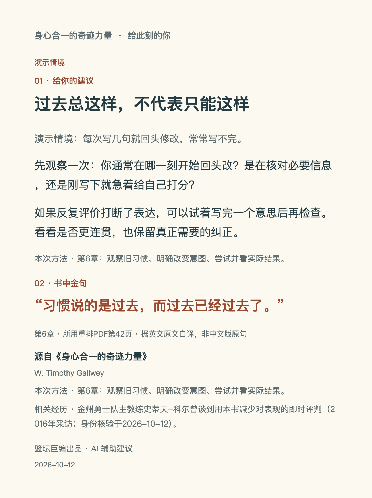

# 《身心合一的奇迹力量》

**让 NBA 冠军教头反复读、雷霆建队操盘手做笔记、“投篮神医”亲自推荐的，竟然是一本网球书。**

**史蒂夫-科尔**，带领勇士四次夺冠的现任主教练。他反复阅读、做笔记，每个休赛期重读，还常备多本送给别人。

**萨姆·普雷斯蒂**，雷霆的建队操盘手、现任执行副总裁兼总经理。他把喜欢的段落整理成专门的文档，也把这本书分享给员工。

**奇普·英格兰德**，人称“投篮神医”，现任火箭助理教练。正是他，把这本书推荐给了史蒂夫-科尔。[人物推荐与阅读经历](https://www.si.com/nba/2016/05/26/steve-kerr-pete-carroll-nba-playoffs-inner-game-tennis-book)

还有**微软联合创始人、盖茨基金会主席比尔·盖茨**。他称这是自己读过最好的网球书，多次重读，并持续送给朋友。[盖茨本人书评](https://www.gatesnotes.com/meet-bill/games-i-love/reader)

**它的价值远不止于体育。在人生的不同阶段，当你被压力、自我怀疑和内耗困住时，也许这本书都能帮到你。**

这个 skill，会陪你把书中的方法用起来。

**你有没有过这种时候：越提醒自己别出错，反而越容易出错？这本书用 Self 1 与 Self 2，解释我们为什么会自己干扰自己，以及怎样减少这种干扰。**

Self 1（自我一），是脑中不停指挥、评价自己的声音；Self 2（自我二），是实际执行、通过体验学习的身心能力。信任 Self 2，也需要学习、练习和反馈。

**看看下面哪一项，正是你想解决的困扰：**

1. **一出错，就忍不住否定自己**  
   用“不加评判的观察”，看清发生了什么，从错误中找到有用的反馈。

2. **越想做好，反而越发挥不出来**  
   理解 Self 1 与 Self 2 的关系，减少反复指挥和检查自己，让学习与发挥更顺畅。

3. **下定决心改变，却总回到老样子**  
   看清旧习惯怎样发生，再通过尝试和反馈，找到新的做法。

4. **脑子停不下来，做事很难投入**  
   练习把注意力放回眼前的事情，减少对自己表现的反复打分。

5. **曾经喜欢的事，现在只剩压力**  
   理清自己为什么参与，重新找到愿意投入的理由。

6. **很想赢，又特别怕输**  
   学着认真争胜，同时不让一次输赢决定你怎么看自己。

7. **反复后悔过去，总在担心以后**  
   分清眼前的现实和脑中的推演，把注意力带回现在。

这些方法关注学习、发挥和心理干扰；具体的专业技术与现实难题，仍需要相应的知识和支持。

**选一个编号，或者直接说说最近困扰你的事。**

**让书里的智慧，成为你解决眼前问题的方法。**


## 安装与调用

把本仓库链接交给支持 Agent Skills 安装的工具，请它安装仓库根目录 SKILL.md 对应的 skill。也可完整克隆到工具的 skills 目录，文件夹名为 life-coach。请保留其余资料与模板，不要只复制 SKILL.md。

安装后输入“身心合一的奇迹力量”会看到简短入口；输入“完整介绍”显示上面的完整版本。直接描述问题则进入辅导，不先展示欢迎目录。

## 建议卡与 PNG

有具体建议且有匹配的已核验短句时，生成“给你的建议＋书中金句”两块式页卡。当前库有4条短引文，覆盖学习、习惯、专注、竞争；观察、动机、过去未来困扰三类暂缺匹配金句，仍正常给文字建议，不用无关句子凑卡。

HTML生成仅依赖Python 3标准库；浏览器可保存图片。纯CLI也可直接导出PNG：

```sh
python -m pip install 'Pillow>=10,<13'
python resources/scripts/render_card.py examples/input.json --out cards --png
```

PNG需中文字体，自动查找macOS、Windows及Linux常用字体；Linux可安装Noto Sans CJK，也可加 `--font /path/to/chinese-font.ttf`。PNG失败时，脚本仍返回HTML/JSON路径，退出码2及明确原因；不能把失败报告为成功。



[HTML示例](examples/advice-card.html)可保存到本地打开。

## 测试

```sh
python -m unittest discover -s resources/tests -v
```

GitHub Actions会安装Pillow与中文字体并执行上述测试。检查输入/链接、转义、引用编号和主方法匹配、输出文件、中文PNG、长文及依赖失败处理。不把这些工程检查当成辅导有效性的证据。

另有[16个情境的评测标准](evals/cases.json)、[实际回答与独立审阅报告](evals/report.md)。对话评测需要模型实际执行，不能靠单元测试自动证明。

## 来源与限制

本项目使用 cangjie-skill 构造和编译。正式出版社的书目和第1章公开摘录已核对；未取得可逐页阅读的完整正式版，因此不宣称完成完整原版蒸馏。

当前4条短引文逐句对照研究用87页重排PDF，均标中文自译，非正式中文版原句。出版社书目认证、片段核验和全书核验分别记录在[原文核验说明](resources/references/source-audit.md)。仓库不包含原书全文。

人物身份核验日期为2026-10-12，未来可能变化。推荐经历不证明普遍效果；本工具不提供具体技术教学、求职方案或疾病治疗。
# 宿主兼容性说明

已验证本地 Python 导出，尚未在豆包中完成端到端验证。安装 skill 不等于宿主拥有 Python、文件下载或 HTML 制品工具。出卡只使用内置引用，不临时找书；缺引用当轮说明，缺导出能力提供排版文本并说明限制，不声称图片已生成。

